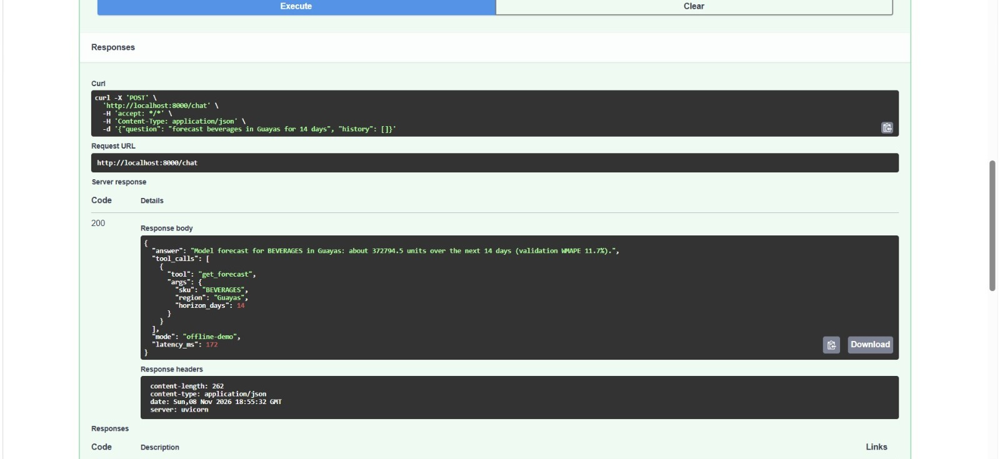
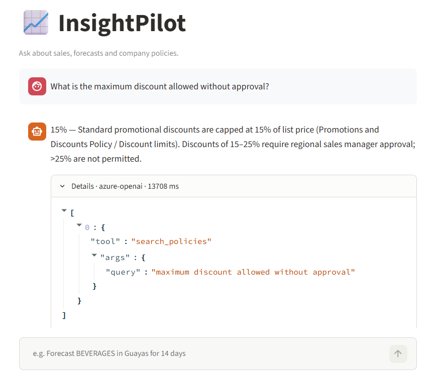
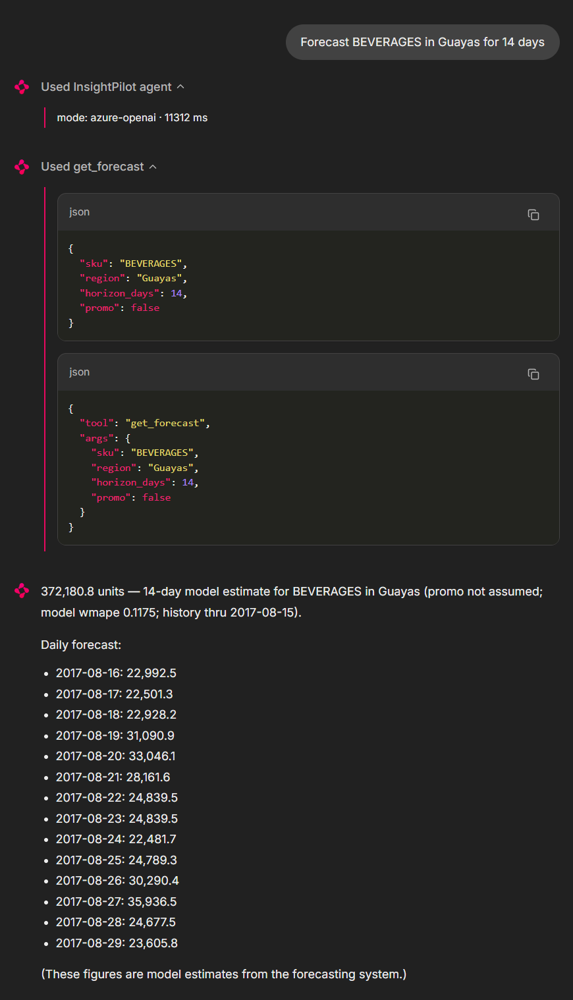
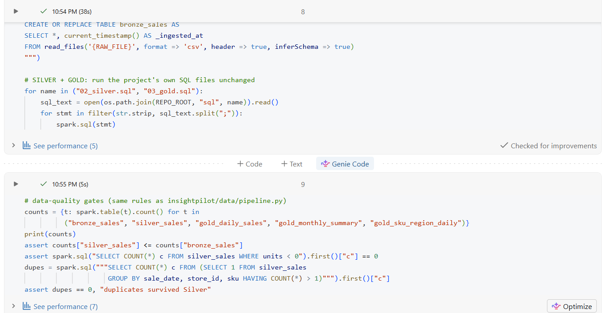
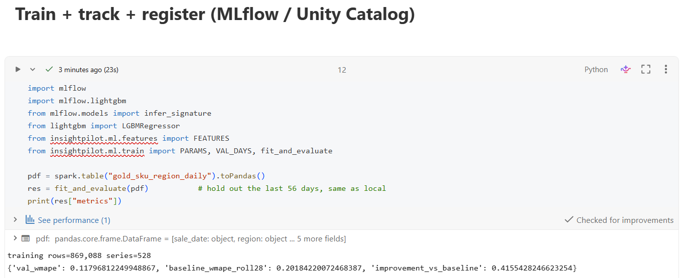
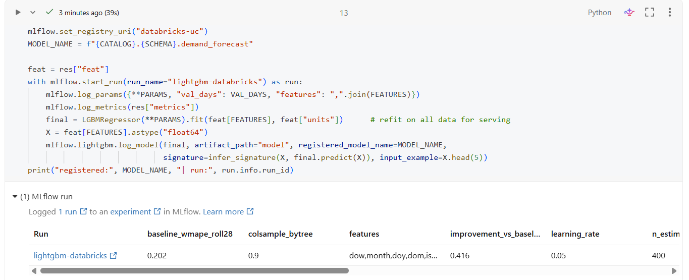
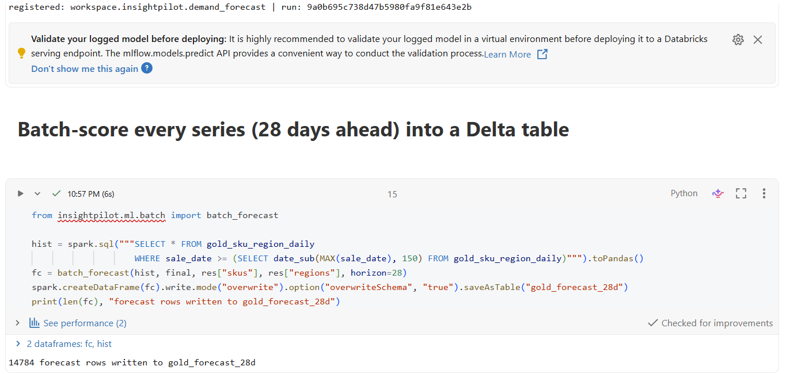
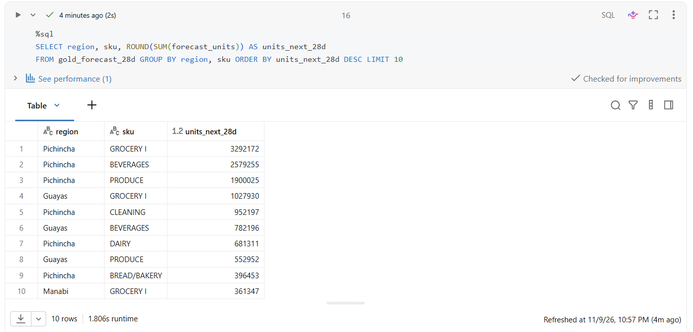
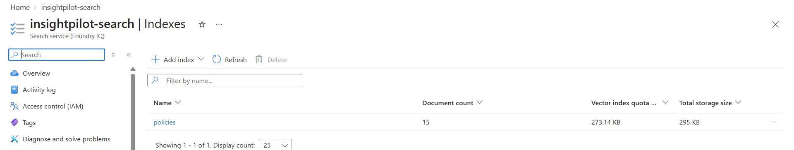
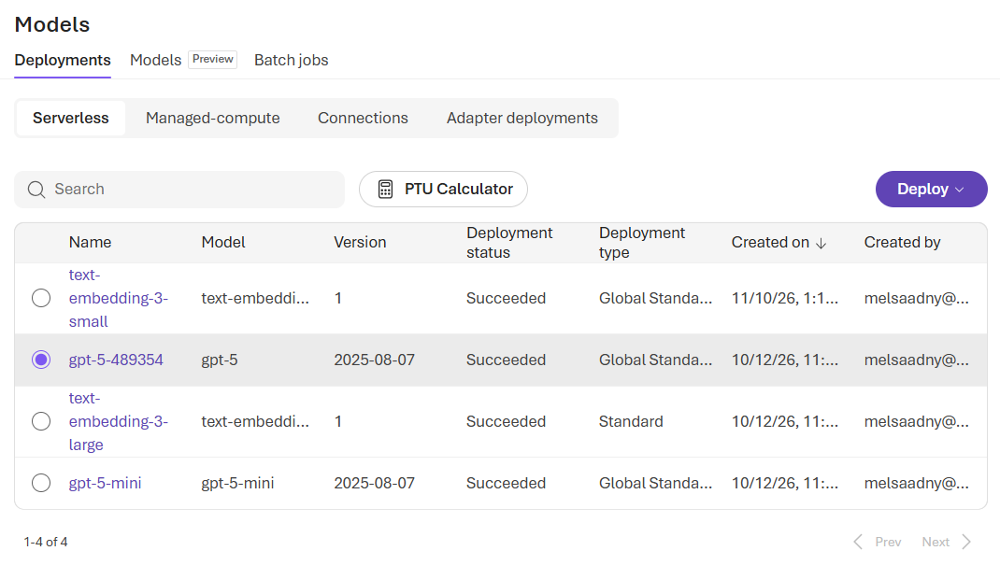

# InsightPilot — AI Copilot for Sales & Supply-Chain Teams

An end-to-end AI system that lets business users ask questions in plain language and get answers that are
**grounded in data, forecasts and company policy**: no hallucinated numbers.

> "Forecast BEVERAGES in Guayas for the next 14 days" → ML demand forecast
> "Top categories by units sold?" → governed SQL on the warehouse
> "What's the max promo discount?" → retrieved policy, cited

## Business problem
Commercial teams (Route-to-Market, Revenue Growth Management, Supply Chain, Finance) wait on analysts for
routine questions: past performance, expected demand, and "what are the rules?". InsightPilot answers all three
in seconds through one interface, and exposes the same capabilities to other systems via REST and MCP.
Expected impact: fewer ad-hoc analyst requests, faster promo/replenishment decisions, one governed source of truth.

## Architecture
```
 raw sales ─► BRONZE ─► SILVER (clean, dedupe) ─► GOLD ──┬─► Demand model (LightGBM, MLflow) ─┐
 (CSV/ERP)     Delta/DuckDB                              └─► SQL tool (read-only, guarded)   │
 policy docs ─► chunk ─► Azure AI Search (hybrid) ─────────► Retrieval tool                   │
                                                                                              ▼
 Chat UI ─► FastAPI /chat ─► Agent (Azure OpenAI function calling) ◄── tools ──► MCP server (any MCP client)
              │ Docker ─► Azure Container Apps · CI/CD GitHub Actions · API-key auth · latency/tool logging
```
| Layer | Local (tested) | Cloud target |
|---|---|---|
| Lakehouse | DuckDB, `sql/*.sql` | Databricks Delta + Unity Catalog (**verified** on Free Edition) |
| ML tracking/registry | MLflow (SQLite) | Databricks MLflow + Unity Catalog model registry (**verified**) |
| Forecast serving | in-process model | Batch-scored Delta table `gold_forecast_28d` (**verified**); Model Serving endpoint: planned |
| Retrieval | TF-IDF | Azure AI Search hybrid (keyword + vector) (**verified**) |
| LLM | offline demo router | Azure OpenAI `gpt-5-mini` function calling (**verified**) |
| Hosting | uvicorn | Docker → Azure Container Apps |

## Results (real data: Favorita, 3.0M rows)
Dataset: Kaggle *Store Sales – Time Series Forecasting* (54 stores, 33 product families, 16 regions, 2013–2017).
The model forecasts 528 series (family × region) 28 days ahead and is evaluated on the **last 56 days, held out from training**.

| Metric | Value |
|---|---|
| Forecast WMAPE (LightGBM) | **11.7 %** vs 20.2 % naive baseline (**−42 %** error) |
| Same pipeline on Databricks | 11.8 % vs 20.2 % (library-version differences) |
| Retrieval hit@1 / hit@3 | 100 % / 100 % (10 questions; TF-IDF and Azure AI Search hybrid) |
| SQL-injection/forbidden-query attempts blocked | 6 / 6 |
| Agent tool-routing accuracy | 3 / 3 offline router · 3 / 3 with Azure OpenAI (`gpt-5-mini`) |
| Automated tests | 32 passing (pipeline, ML, batch scoring, security, RAG, API, MCP, real-data ingest) |



Baseline = rolling 28-day mean of past demand. Features: calendar, promotion intensity, national holidays, oil price, 28-day lag/rolling demand.
**CI runs on a synthetic dataset** (no Kaggle access in CI); the real-data numbers above come from running the ingest locally (`make eval` or `python -m eval.run_eval`).

## Chat UI
Start the API (`uvicorn insightpilot.api.main:app`; for real data set `INSIGHTPILOT_HOME` to the Favorita store in the API's shell), then run `make ui` (= `chainlit run ui/app.py -w`). With the Azure keys in `.env` the
assistant uses Azure OpenAI function calling; without keys it falls back to the offline demo router.




## Quick start
Synthetic demo data (no downloads needed):
```bash
make setup && make bootstrap     # generate data → Bronze/Silver/Gold → train + register model
make test && make eval
make api                         # http://localhost:8000/docs
make ui                          # chat UI
make mcp                         # MCP server (stdio)
```
Real data (Windows PowerShell; download the Favorita files from Kaggle first):
```powershell
$env:INSIGHTPILOT_HOME = "$PWD\store\favorita"
python -m insightpilot.data.ingest_favorita --src <path-to-favorita-folder>
python -m insightpilot.bootstrap
python -m eval.run_eval
uvicorn insightpilot.api.main:app --reload
```
Works offline with zero keys (demo router). Copy `.env.example` → `.env` and add Azure keys for full LLM + vector search.

## Key engineering decisions
- **No train/serve skew**: one `build_features()` for training and serving.
- **28-day lag features** → any horizon ≤ 28 days is forecast in one pass from real history (no recursive error). Lags are computed on a complete daily calendar, so closed-store days (e.g. Dec 25) never shift them.
- **Domain features:** promotion intensity, national holidays (moved holidays and make-up work days handled), oil price, pay-days.
- **Schema-checked ingest:** missing or renamed source columns fail fast with a clear message.
- **One codebase, two runtimes:** the same Silver/Gold SQL files and the same feature/training code run locally (DuckDB) and on Databricks (Spark), so results are directly comparable.
- **Safe text-to-SQL**: single `SELECT/WITH` only, keyword/function deny-list, **read-only connection with external access disabled**, 200-row cap, queries only the Gold layer. Defence in depth.
- **Data-quality gates** in the pipeline fail the run instead of serving bad data.
- **Tools defined once**, reused by the agent, REST API and MCP server.
- **Errors go back to the model** so it can self-correct; step limit prevents loops.
- **Offline-first tests:** the test suite blanks all Azure variables, so it never touches cloud resources even when a real `.env` exists.
- Auth via API key (secret store in cloud), structured logs of tool calls + latency.

## Databricks (verified)
`databricks/01_medallion_and_mlflow.py` runs the **same SQL and training code** on Databricks Free Edition
(serverless): Delta Bronze/Silver/Gold (3.0M rows) → MLflow run → model registered in Unity Catalog →
28-day batch forecasts for all 528 series in the `gold_forecast_28d` Delta table.
Setup: clone this repo as a Databricks Git folder, upload `sales_raw.csv` to a Unity Catalog volume, run the notebook.







## Azure deployment
1. Create Azure OpenAI (chat + `text-embedding-3-small` deployments) and Azure AI Search.
2. `python -m insightpilot.rag.retriever` → indexes policies into AI Search.
3. `bash infra/deploy_azure.sh` → builds in ACR and deploys to Container Apps (scale-to-zero).
4. Set a **cost budget alert** first. Move secrets to Key Vault for production.

> `gpt-5-mini` is a reasoning model: no `temperature` is sent and answers take roughly 8-16 s. Azure AI Search runs on the
> Free tier (50 MB, no SLA). Verified live: index `policies` (15 chunks), hybrid retrieval and the function-calling agent loop.




> **Honest status:** local stack, tests, eval, real-data (Favorita) runs, the Databricks pipeline
> (Delta medallion, MLflow, Unity Catalog registry, batch forecasts) and the Azure OpenAI + Azure AI Search path
> (hybrid retrieval, function-calling agent) are verified against live resources. `deploy_azure.sh` (Container Apps)
> is written to the CLI docs but **not yet run**; expect small fixes on first deploy. Databricks Model Serving is
> not used (Free Edition): forecasts are batch-scored into the `gold_forecast_28d` Delta table.

## Use cases it adapts to (swap data + docs, keep the platform)
Route-to-Market (outlet/route questions) · Revenue Growth Management (promo effectiveness, price rules) ·
Supply Chain (demand-driven safety stock) · Finance (credit/returns policy Q&A, sales analytics).

## Evaluation & next steps
- Add LLM-as-judge for groundedness/answer-relevance on a golden set now that Azure OpenAI is attached.
- Add prices to enable revenue and price-elasticity analysis (Favorita has units only); add hierarchical/Prophet baselines and prediction intervals.
- Expose forecasts through a Databricks Model Serving endpoint (paid tier); add drift monitoring and a scheduled retraining job.
